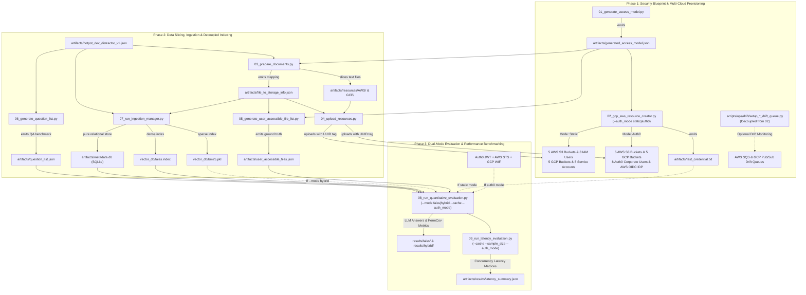
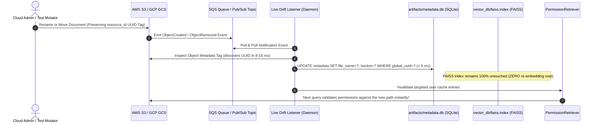

# Permission-Aware RAG: Pipeline & Architecture Guide (`PIPELINE_GUIDE.md`)

This guide is the complete, authoritative reference for the **Permission-Aware Multi-Cloud RAG** system. It details the end-to-end architecture, every script in `scripts/`, operational utilities in `scripts/ops/`, the web dashboard in `web/`, the consolidated test suite in `tests/`, and the dual authentication mechanics across **Static IAM Mode** and **Auth0 Federated Mode**.

---

## 1. End-to-End Pipeline Architecture



---

## 2. Dual-Engine Authentication Bridge

The pipeline switches between traditional static credentials and enterprise federated identity dynamically without changing retrieval or evaluation code:

```mermaid
flowchart LR
    EVAL["08 Evaluation / 09 Latency / Web App"] --> CM["CredentialManager<br/>(src/managers/credential_manager.py)"]
    
    subgraph ModeStatic["Mode A: AUTH_MODE='static' (Traditional IAM)"]
        CM -->|Loads| T_TXT["artifacts/test_credential.txt"]
        T_TXT --> AWS_STATIC["Static AWS Access Keys (AKIA...)"]
        T_TXT --> GCP_STATIC["GCP Service Account JSON Keys"]
        AWS_STATIC --> AF_S["AdapterFactory"]
        GCP_STATIC --> AF_S
    end
    
    subgraph ModeAuth0["Mode B: AUTH_MODE='auth0' (Enterprise OIDC Federation)"]
        CM -->|Password Realm Grant| AUTH0["Auth0 IdP Tenant"]
        AUTH0 -->|Returns ID Token| JWT["OpenID Connect JWT (eyJ...)"]
        JWT -->|AssumeRoleWithWebIdentity| AWS_STS["AWS STS (ASIA... Temporary Keys)"]
        JWT -->|Workload Identity Federation| GCP_STS["GCP STS (ya29... Temporary Access Token)"]
        AWS_STS --> AF_A["AdapterFactory"]
        GCP_STS --> AF_A
    end
    
    AF_S --> PR["PermissionRetriever & PermissionCache<br/>(src/retrievers/permission_retriever.py)"]
    AF_A --> PR
    
    PR -->|Cache Hit (0.05 ms)| CACHE_HIT["In-Memory TTL Decision Cache (300s TTL)"]
    PR -->|Cache Miss (10-40 ms)| S3_GCS["Cloud Storage Permission Check<br/>(s3.head_object / gcs.get_blob)"]
    CACHE_HIT --> LLM["QuestionProcessor (Grounded Gemini / OpenAI)"]
    S3_GCS --> LLM
```

---

## 3. Real-Time Cloud Drift Architecture (Zero Re-Indexing)

When storage administrators move, rename, or reorganize objects in AWS S3 or GCP GCS, permissions dynamically update without re-computing sentence embeddings or rebuilding vector indices:



---

## 4. Main Pipeline Script Catalog (`01` through `09`)

### `01_generate_access_model.py`
* **What it Does:**
  Generates the core security architecture blueprint. Generates an 8-character project prefix (e.g., `bwtkuhmc`), 5 AWS ABAC bucket rules, 5 GCP RBAC role mappings, 8 user profiles (`user-1` to `user-7`, `baseline-admin`), and assigns access privileges.
* **Prerequisites:** Pure Python (no external dependencies, no cloud credentials required).
* **CLI Arguments:** None.
* **Outputs:**
  - `artifacts/generated_access_model.json`
* **Modules Used:** `random`, `json`, `string`, `pathlib.Path`.

---

### `02_gcp_aws_resource_creator.py`
* **What it Does:**
  Provisions cloud storage and identity infrastructure according to `generated_access_model.json`.
  1. **Strict Region Pre-flight Validation:** Enforces explicit `AWS_REGION` and `GCP_BUCKET_LOCATION` in `config/.env`; halts immediately if missing (zero default fallback).
  2. **Storage Buckets:** Creates 5 AWS S3 buckets and 5 GCP Cloud Storage buckets.
  3. **Identity Provisioning (Dual-Mode):**
     - If `--auth_mode static`: Creates 8 AWS IAM users + `abac-test-group` + 5 ABAC policies, and 8 GCP Service Accounts; emits access keys to `test_credential.txt`.
     - If `--auth_mode auth0`: Syncs 8 users to Auth0 Cloud Directory with security metadata tags, registers AWS OIDC Identity Provider & `Corporate-RAG-Auth0-Role`, and emits a federated user roster to `test_credential.txt`.
  4. **Drift Queue Decoupling:** Event queues (`setup_drift_queues()`) are isolated from the main flow to prevent unintentional drift resources during standard provisioning.
* **Prerequisites:**
  - `artifacts/generated_access_model.json`
  - AWS & GCP admin credentials in `config/.env`.
* **CLI Arguments:**
  - `--auth_mode [static|auth0]` (Default: loaded from `AUTH_MODE` in `config/.env`).
* **Outputs:**
  - Live AWS S3 & GCP GCS buckets.
  - Live IAM users/policies (Static Mode) OR live Auth0 users & AWS OIDC provider (Auth0 Mode).
  - `artifacts/test_credential.txt` (credentials or federated roster).
* **Modules Used:** `boto3`, `googleapiclient.discovery`, `google.auth`, `scripts.ops.identity.*`.

---

### `03_prepare_documents.py`
* **What it Does:**
  Extracts documents from the HotpotQA multi-hop benchmark, sanitizes titles, randomly distributes each document across the AWS and GCP buckets, and writes individual `.txt` files under directory trees matching their cloud destinations.
* **Prerequisites:**
  - `artifacts/hotpot_dev_distractor_v1.json` (Dataset)
  - `artifacts/generated_access_model.json` (Bucket names)
* **Outputs:**
  - `artifacts/resources/AWS/<bucket_name>/<doc_title>.txt`
  - `artifacts/resources/GCP/<bucket_name>/<doc_title>.txt`
  - `artifacts/file_to_storage_info.json` (Maps each file to its `global_uuid`, provider, bucket, region, and IAM type).
* **Modules Used:** `uuid`, `re`, `json`, `tqdm`.

---

### `04_upload_resources.py`
* **What it Does:**
  Reads local document files created by step 03 and uploads them concurrently using thread pools directly into live AWS S3 and GCP GCS buckets, attaching `resource_id = <global_uuid>` metadata tags to each cloud object.
* **Prerequisites:**
  - `artifacts/file_to_storage_info.json`
  - `artifacts/resources/` (Local document text files)
  - Cloud admin credentials in `config/.env`
* **Outputs:**
  - Populates all 10 cloud buckets with live documents tagged with immutable UUIDs.
* **Modules Used:** `boto3`, `google.cloud.storage`, `concurrent.futures.ThreadPoolExecutor`.

---

### `05_generate_user_accessible_file_list.py`
* **What it Does:**
  Calculates the mathematical ground-truth visibility matrix. For each of the 8 users, it cross-references their assigned AWS attributes and GCP roles against bucket locations, producing the exact list of files each user is authorized to access.
* **Prerequisites:**
  - `artifacts/generated_access_model.json`
  - `artifacts/file_to_storage_info.json`
* **Outputs:**
  - `artifacts/user_accessible_files.json` (Used by the evaluation engine to compute TP, FP, FN, TN, and PermissionCoverage).
* **Modules Used:** Pure Python (`collections.defaultdict`, `json`).

---

### `06_generate_question_list.py`
* **What it Does:**
  Extracts multi-hop reasoning questions, gold answers, and supporting fact titles from the HotpotQA distractor dataset into a normalized test question catalog.
* **Prerequisites:**
  - `artifacts/hotpot_dev_distractor_v1.json`
* **Outputs:**
  - `artifacts/question_list.json`
* **Modules Used:** Pure Python (`json`, `pathlib.Path`).

---

### `07_run_ingestion_manager.py`
* **What it Does:**
  Initializes the decoupled RAG index storage engine:
  1. Computes dense sentence embeddings using HuggingFace `all-MiniLM-L6-v2`.
  2. Builds dense FAISS vector index (`vector_db/faiss.index`).
  3. Builds sparse BM25 lexical index (`vector_db/bm25.pkl`).
  4. Populates a pure SQLite relational store (`artifacts/metadata.db`) that maps document UUIDs to cloud storage coordinates (WAL mode, zero legacy JSON dependency).
* **Prerequisites:**
  - `artifacts/hotpot_dev_distractor_v1.json`
  - `artifacts/file_to_storage_info.json`
* **Outputs:**
  - `artifacts/metadata.db` (SQLite relational store)
  - `vector_db/faiss.index` (Dense vector index)
  - `vector_db/faiss_metadata.json` (UUID mapping for FAISS)
  - `vector_db/bm25.pkl` (Sparse BM25 index)
* **Modules Used:** `src.managers.ingestion_manager.IngestionManager`, `sentence_transformers`, `faiss`, `rank_bm25`, `sqlite3`.

---

### `08_run_quantitative_evaluation.py`
* **What it Does:**
  The core evaluation benchmark. For each user (`user-1`, `user-3`, `baseline-admin`):
  1. Retrieves top-k documents using FAISS dense search or Hybrid (Dense + BM25 RRF).
  2. Passes retrieved documents through `PermissionRetriever`, executing live IAM checks against AWS/GCP buckets using user credentials.
  3. Supports `--cache` for in-memory TTL decision caching (300s TTL, 0.05 ms response on repeats).
  4. Feeds authorized context into the grounded LLM (Gemini or OpenAI) to generate answers.
  5. Computes Exact Match (EM), F1 score, EM@Admin (leakage ratio), and PermissionCoverage against ground truth.
* **Prerequisites:**
  - Artifacts from steps 01–07.
  - LLM Key: `GOOGLE_GEMINI_API_KEY` or `OPENAI_API_KEY`.
  - Identity Credentials (via `test_credential.txt` for static mode, or `config/.env` for Auth0 mode).
* **CLI Arguments:**
  - `--mode [faiss|hybrid]` (Default: `faiss`)
  - `--top_k [N]` (Default: `5`)
  - `--auth_mode [static|auth0]` (Default: loaded from `config/.env`)
  - `--cache` (Flag: enables in-memory TTL decision caching)
* **Outputs:**
  - `results/<mode>/quantitative_summary.json`
  - `results/<mode>/quantitative_details.json`
  - `results/<mode>/preds/preds_<user>.json`
  - `results/<mode>/test_metrics.txt`
* **Modules Used:** `src.retrievers.hybrid_retriever`, `src.retrievers.permission_retriever`, `src.managers.credential_manager`, `src.processors.question_processor`.

---

### `09_run_latency_evaluation.py`
* **What it Does:**
  Profiles system throughput and response times. Benchmarks retrieval and IAM permission filtering overhead across multiple thread concurrencies (`max_workers` from 1 to 20) and varying result depths (`top_k` from 1 to 20). Demonstrates the ~3x speedup when in-memory TTL caching is enabled.
* **Prerequisites:**
  - `artifacts/question_list.json`, `artifacts/metadata.db`, `vector_db/*`, credentials.
* **CLI Arguments:**
  - `--cache` (Flag: enables in-memory TTL decision caching during benchmark)
  - `--auth_mode [static|auth0]` (Default: loaded from `config/.env`)
  - `--sample_size [N]` (Default: `50`)
* **Outputs:**
  - Console latency benchmark reports and timing matrices.
  - `artifacts/results/latency_summary.json`
* **Modules Used:** `src.stores.vector_store`, `src.stores.metadata_store`, `src.retrievers.permission_retriever`, `src.processors.question_processor`.

---

## 5. Operations & Lifecycle Catalog (`scripts/ops/`)

### `scripts/ops/cloud/` (Storage & IAM Provisioning)
| File | Job | Prerequisites | Outputs |
| :--- | :--- | :--- | :--- |
| `provision_aws.py` | Standalone AWS provisioner. Creates 5 S3 buckets, 8 IAM users, and ABAC policies. | `config/.env`, `generated_access_model.json` | 5 S3 buckets, 8 IAM users, updates `test_credential.txt` |
| `provision_gcp.py` | Standalone GCP provisioner. Creates 5 GCS buckets and 8 Service Accounts. | `config/.env`, `generated_access_model.json` | 5 GCS buckets, 8 Service Accounts, updates `test_credential.txt` |
| `deprovision_aws.py` | Wipes and deletes all 5 S3 buckets, 8 IAM users, group, and policies. | `AWS_ADMIN_*` keys in `config/.env` | Complete deletion of AWS storage & IAM |
| `deprovision_gcp.py` | Wipes and deletes all 5 GCS buckets and 8 Service Accounts. | `GCP_ADMIN_KEY_PATH` in `config/.env` | Complete deletion of GCP storage & SAs |
| `cleanup_resources.py` | Core engine called by `deprovision_aws` and `deprovision_gcp`. Contains safety checks and pagination loops. | Cloud admin credentials | Clean cloud state |

---

### `scripts/ops/identity/` (Corporate IdP & Federation)
| File | Job | Prerequisites | Outputs |
| :--- | :--- | :--- | :--- |
| `auth0_create_user.py` | Provisions 8 users in Auth0 tenant matching `generated_access_model.json` with metadata tags. Uses `AUTH0_DEFAULT_PASSWORD`. | `AUTH0_DOMAIN`, `AUTH0_CLIENT_ID`, `AUTH0_CLIENT_SECRET` | 8 active Auth0 identities (`user-1@company.internal`, etc.) |
| `auth0_delete_user.py` | Queries Auth0 API v2 and deletes all `@company.internal` users. | Auth0 credentials, `generated_access_model.json` | Clean Auth0 directory (0 users) |
| `auth0_modify_user.py` | Dynamically updates a user's metadata in Auth0 (used for testing live permission drift without restarting the app). | Auth0 credentials, target username and tags | Updated Auth0 user profile |
| `setup_aws_idp.py` | Registers Auth0 as an OIDC Identity Provider in AWS IAM and creates `Corporate-RAG-Auth0-Role`. | AWS admin keys, `AUTH0_DOMAIN`, `AUTH0_CLIENT_ID` | `artifacts/aws_idp_blueprint.json`, live IAM OIDC Provider |
| `deprovision_aws_idp.py` | Detaches policies, deletes `Corporate-RAG-Auth0-Role`, and deletes the Auth0 OIDC provider from AWS. | AWS admin keys | Complete deletion of AWS federation assets |
| `setup_gcp_idp.py` | Configures GCP Workload Identity Pool (`auth0-pool`) and OIDC provider (`auth0-provider`). | GCP Admin permissions, `gcloud` SDK | Live GCP Workload Identity Pool |
| `deprovision_gcp_idp.py` | Soft-deletes GCP Workload Identity Pool (subject to GCP's 30-day tombstone). | GCP Admin permissions | Soft-deleted GCP pool |

---

### `scripts/ops/drift/` (Event Queues & Real-Time Listeners)
| File | Job | Prerequisites | Outputs |
| :--- | :--- | :--- | :--- |
| `setup_aws_drift_queue.py` | Creates SQS queue `permission-rag-drift-queue` and configures S3 bucket event notifications. | AWS admin credentials | SQS queue connected to S3 events |
| `deprovision_aws_drift_queue.py` | Detaches S3 bucket event notifications and deletes the SQS queue. | AWS admin credentials | Clean SQS state |
| `setup_gcp_drift_queue.py` | Creates GCP Pub/Sub topic and subscription for Cloud Storage object change notifications. | GCP admin credentials | Pub/Sub topic & subscription |
| `deprovision_gcp_drift_queue.py` | Deletes GCP Pub/Sub topic and subscription. | GCP admin credentials | Clean Pub/Sub state |
| `live_aws_drift_listener.py` | Daemon that polls SQS for S3 permission events and atomically updates `metadata.db` in < 5 ms. | AWS SQS credentials | Real-time SQLite metadata sync |
| `live_gcp_drift_listener.py` | Daemon that streams Pub/Sub messages and atomically updates `metadata.db` in < 5 ms. | GCP credentials | Real-time SQLite metadata sync |
| `gcp_aws_drift_listener.py` | Unified multi-cloud daemon monitoring both AWS SQS and GCP Pub/Sub simultaneously. | Both AWS and GCP credentials | Unified multi-cloud drift listener |

---

### `scripts/ops/utils/` (Orchestration & Verification)
| File | Job | Prerequisites | Outputs |
| :--- | :--- | :--- | :--- |
| `run_teardown_sequence.py` | Orchestrator that reads `teardown_sequence.txt` and executes all 8 teardown steps one-by-one. Supports `--help` and `--list`. | `teardown_sequence.txt` | Complete system teardown with step-by-step timing table |
| `clean_generated_data.py` | Resets local state by removing generated `.txt`, `.json`, SQLite `metadata.db`, vector indices, and previous results. | Protected pattern safeguards | Clean local state (preserves `config/.env`, dataset, admin keys) |
| `audit_cloud_resources.py` | 100% read-only health check that queries Auth0, AWS, and GCP live APIs to confirm 0 remaining resources. | Admin credentials in `config/.env` | Multi-cloud resource audit dashboard |

---

## 6. Consolidated Test Suite Catalog (`tests/`)

The repository contains **10 authoritative, consolidated test suites** with direct bridges to pipeline scripts and core components:

| Test Suite | Bridge / Target | Execution Mode | Scope & Validations |
| :--- | :--- | :---: | :--- |
| **`test_pipeline_02_resource_creator.py`** | `scripts/02_gcp_aws_resource_creator.py` | Offline (Mocked) | Tests CLI parsing (`--auth_mode`), drift decoupling, static credential formatting, Auth0 federation, and dynamic STS dispatch without real cloud calls. |
| **`test_pipeline_08_evaluation.py`** | `scripts/08_run_quantitative_evaluation.py` | Offline (Mocked) | Tests CLI flags (`--mode`, `--top_k`, `--auth_mode`, `--cache`), cache toggle propagation into `QuestionProcessor`, metrics calculations, header formatting, and zero security leak verification. |
| **`test_pipeline_09_latency.py`** | `scripts/09_run_latency_evaluation.py` | Offline (Mocked) | Tests CLI flags (`--cache`, `--sample_size`, `--auth_mode`), environment sync, in-memory cache speedup (~3x), 0.05ms sub-millisecond duration recording, and `latency_summary.json` schema. |
| **`test_metadata_store.py`** | `src/stores/metadata_store.py` | Offline (Temp DB) | Tests pure SQLite CRUD operations, zero legacy JSON dependency, atomic path/bucket updates in < 5 ms, and multi-threaded concurrency without DB locks. |
| **`test_permission_cache.py`** | `src/retrievers/permission_retriever.py` | Offline (In-Memory) | Tests in-memory TTL caching, cache hit/miss behavior, TTL expiration, sub-millisecond latency, and thread-safe targeted user eviction (`invalidate_user`). |
| **`test_strict_region_enforcement.py`** | `validate_region_prerequisites()` | Offline (Subshell) | Verifies zero-fallback strict regional policy on AWS (`ap-south-1`) and GCP (`asia-south1`), ensuring missing region configs immediately halt execution. |
| **`test_all_users_multicloud_matrix.py`** | Auth0 OIDC + AWS STS + GCP WIF | Live Cloud | Comprehensive live matrix verifying Auth0 login, AWS STS token minting, GCP WIF token exchange, and bucket allow/deny boundaries across all 8 blueprint users simultaneously. |
| **`test_aws_drift_resolution.py`** | AWS S3 &rarr; SQS &rarr; Live Listener | Live Cloud | Tests live SQS event reception, UUID discovery via cloud metadata, atomic SQLite update (< 5 ms), and zero FAISS re-embedding verification. |
| **`test_gcp_drift_resolution.py`** | GCP GCS &rarr; Pub/Sub &rarr; Live Listener | Live Cloud | Tests live Pub/Sub event reception, custom metadata extraction, atomic SQLite update (< 5 ms), and zero FAISS re-embedding verification. |
| **`test_modify_cloud_objects.py`** | Cloud Storage Object Mutator | Live Cloud | Live test harness to rename/move objects in S3 and GCS buckets to test real-time drift listeners. |

---

## 7. Web Dashboard Integration (`web/`)

The repository includes a web dashboard built with Flask and modular blueprints:
* **Entry Point:** `web/app.py` (Creates app factory, serves static SPA from `web/static/index.html`).
* **API Endpoints (`/api/`):**
  - `/api/status`: Queries system readiness, cloud connection health, and active identity mode.
  - `/api/dataset`: Surfaces documents, buckets, access models, and ground-truth visibility.
  - `/api/query`: Interactive live RAG search with permission enforcement for any chosen user profile.
  - `/api/metrics`: Renders quantitative evaluation summaries and latency charts.
* **Launch Command:**
  ```powershell
  python -m flask --app web.app run --port 5000
  ```

---

## 8. Master Credentials & Configuration Reference (`config/.env`)

All configurations are strictly unified in [`config/.env`](file:///c:/Users/pichi/Desktop/Permission%20Aware%20RAG/permission-aware-rag/config/.env):

```
========================================================================================================================
 CONFIGURATION VARIABLE             STATIC MODE          AUTH0 MODE         DESCRIPTION
========================================================================================================================
 AWS_ADMIN_ACCESS_KEY               REQUIRED             REQUIRED           AWS IAM Admin access key for provisioning
 AWS_ADMIN_SECRET_KEY               REQUIRED             REQUIRED           AWS IAM Admin secret key for provisioning
 AWS_REGION                         REQUIRED             REQUIRED           Strict AWS deployment region (e.g. ap-south-1)
 GCP_PROJECT_ID                     REQUIRED             REQUIRED           Google Cloud Platform project identifier
 GCP_BUCKET_LOCATION                REQUIRED             REQUIRED           Strict GCS deployment location (e.g. asia-south1)
 GCP_ADMIN_KEY_PATH                 REQUIRED             REQUIRED           Path to Service Account JSON admin key
 GOOGLE_GEMINI_API_KEY              REQUIRED             REQUIRED           API Key for Gemini grounded LLM inference
 AUTH_MODE                          "static"             "auth0"            Active authentication bridge mode
 AUTH0_DOMAIN                       NOT USED             REQUIRED           Auth0 corporate tenant domain
 AUTH0_CLIENT_ID                    NOT USED             REQUIRED           Auth0 SPA / Management client ID
 AUTH0_CLIENT_SECRET                NOT USED             REQUIRED           Auth0 client secret for user management
 AUTH0_ROLE_ARN                     NOT USED             REQUIRED           AWS IAM Role ARN assumed via Auth0 OIDC JWT
 AUTH0_DEFAULT_PASSWORD             NOT USED             REQUIRED           Corporate default password for Auth0 users
 GCP_PROJECT_NUMBER                 NOT USED             REQUIRED           Numeric GCP project number for WIF
 GCP_POOL_ID                        NOT USED             REQUIRED           GCP Workload Identity Pool ID (auth0-pool)
 GCP_PROVIDER_ID                    NOT USED             REQUIRED           GCP Workload Identity Provider ID (auth0-provider)
========================================================================================================================
```

---

## 9. Pipeline Execution Runbooks

### Runbook A: Full Pipeline from Scratch (Static IAM Mode)
```powershell
# 1. Generate security access model blueprint
python scripts/01_generate_access_model.py

# 2. Provision AWS & GCP buckets, IAM users, and static credentials
python scripts/02_gcp_aws_resource_creator.py --auth_mode static

# 3. Slice documents and map them to cloud buckets
python scripts/03_prepare_documents.py

# 4. Upload document text files to live S3 and GCS buckets
python scripts/04_upload_resources.py

# 5. Generate ground-truth user access visibility matrix
python scripts/05_generate_user_accessible_file_list.py

# 6. Extract evaluation QA pairs
python scripts/06_generate_question_list.py

# 7. Build FAISS vector index, BM25 index, and SQLite metadata.db
python scripts/07_run_ingestion_manager.py

# 8. Run quantitative evaluation with Static IAM keys and permission caching
python scripts/08_run_quantitative_evaluation.py --mode faiss --auth_mode static --cache

# 9. Run latency & throughput benchmarks
python scripts/09_run_latency_evaluation.py --auth_mode static --cache
```

---

### Runbook B: Full Pipeline with Auth0 Dynamic Federation Mode
```powershell
# 1. Generate security access model blueprint
python scripts/01_generate_access_model.py

# 2. Provision AWS & GCP buckets, sync Auth0 users, and register AWS OIDC IDP
python scripts/02_gcp_aws_resource_creator.py --auth_mode auth0

# 3. Slice documents and map to cloud buckets
python scripts/03_prepare_documents.py

# 4. Upload document text files with UUID metadata tags
python scripts/04_upload_resources.py

# 5. Generate ground-truth visibility matrix
python scripts/05_generate_user_accessible_file_list.py

# 6. Extract QA benchmark pairs
python scripts/06_generate_question_list.py

# 7. Build FAISS vector index, BM25 index, and SQLite metadata.db
python scripts/07_run_ingestion_manager.py

# 8. Run quantitative evaluation with dynamic Auth0 JWT + AWS STS tokens and cache
python scripts/08_run_quantitative_evaluation.py --mode faiss --auth_mode auth0 --cache

# 9. Run latency benchmarks with Auth0 tokens
python scripts/09_run_latency_evaluation.py --auth_mode auth0 --cache
```

---

### Runbook C: Live Cloud Drift Demonstration (Zero Re-Indexing)
```powershell
# 1. Provision live event queues and attach bucket notifications
python scripts/ops/drift/setup_aws_drift_queue.py
python scripts/ops/drift/setup_gcp_drift_queue.py

# 2. Start live listeners in background terminals
python scripts/ops/drift/live_aws_drift_listener.py
python scripts/ops/drift/live_gcp_drift_listener.py

# 3. Execute cloud object mutation (rename/move files in S3 and GCS)
python tests/test_modify_cloud_objects.py

# 4. Verify in listener logs: SQLite metadata.db updated atomically in < 5 ms!
# 5. Run evaluation again — permissions resolve against new paths with 0 re-indexing!

# 6. Deprovision drift queues when finished
python scripts/ops/drift/deprovision_aws_drift_queue.py
python scripts/ops/drift/deprovision_gcp_drift_queue.py
```

---

### Runbook D: Teardown & Cloud Audit
```powershell
# Preview all 8 teardown steps without deleting anything:
python scripts/ops/utils/run_teardown_sequence.py --list

# Execute complete sequential teardown:
python scripts/ops/utils/run_teardown_sequence.py

# Verify clean cloud state (0 remaining resources):
python scripts/ops/utils/audit_cloud_resources.py
```
