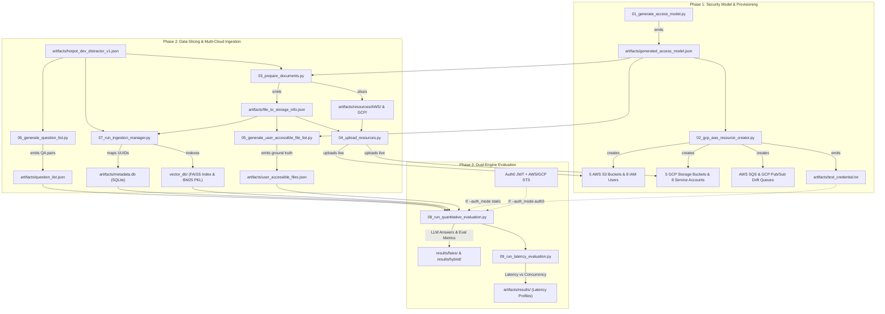
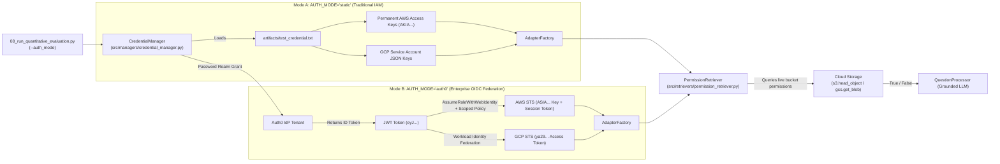

# Permission-Aware RAG: Pipeline & Files Architecture Guide (`PIPELINE_GUIDE.md`)

This guide is the complete reference for every script in the **Permission-Aware RAG** repository. It details what each file does, what prerequisites/inputs it requires, what it outputs, how the scripts connect together, and how credentials are used across both **Static IAM Mode** and **Auth0 Federated Mode**.

---

## 1. End-to-End Pipeline Architecture



---

## 2. Dual-Engine Authentication Bridge (How Authorization Works)

The pipeline can run in two completely distinct identity modes without modifying any retrieval or evaluation code:



---

## 3. Main Pipeline Script Catalog (`01` through `09`)

### `01_generate_access_model.py`
* **What it Does:**
  Generates the core security architecture blueprint. It randomly creates an 8-character project prefix (e.g., `ztcyunnn`), defines 5 AWS ABAC bucket rules, 5 GCP RBAC role mappings, 8 user profiles (`user-1` to `user-7`, `baseline-admin`), and assigns access privileges.
* **What it Needs (Requirements):**
  - Pure Python (no external dependencies, no cloud credentials needed).
* **What it Outputs:**
  - `artifacts/generated_access_model.json`
* **Modules Used:** `random`, `json`, `string`, `pathlib.Path`.

---

### `02_gcp_aws_resource_creator.py`
* **What it Does:**
  Provisions the **Cloud Triad** across AWS and GCP according to `generated_access_model.json`:
  1. **Storage Buckets:** Creates 5 S3 buckets and 5 GCS buckets.
  2. **Drift Queues & Event Notifications:** Creates AWS SQS queue (`permission-rag-drift-queue`) and GCP Pub/Sub topic/subscription, binding event notifications across all 10 buckets for live permission drift tracking.
  3. **IAM Users & Service Accounts:** Creates 8 AWS IAM users (tagged for ABAC) + `abac-test-group` + 5 ABAC policies, and 8 GCP Service Accounts (bound to bucket viewer roles).
  4. **Emits Static Credentials:** Writes permanent access keys and SA JSONs to `test_credential.txt` (used by Static Mode).
* **What it Needs (Requirements):**
  - `artifacts/generated_access_model.json`
  - AWS Credentials: `AWS_ADMIN_ACCESS_KEY`, `AWS_ADMIN_SECRET_KEY`, `AWS_REGION`
  - GCP Credentials: `GCP_PROJECT_ID`, `GCP_ADMIN_KEY_PATH` (`Permission_Aware_Rag_GCP_ADMIN_KEY.json`), `GCP_BUCKET_LOCATION`
* **What it Outputs:**
  - **AWS Cloud:** 5 S3 buckets, 8 IAM users, 1 IAM group (`abac-test-group`), 5 ABAC customer-managed policies, and 1 SQS Drift Queue (`permission-rag-drift-queue`) attached to S3 event notifications.
  - **GCP Cloud:** 5 Cloud Storage buckets, 8 Service Accounts with IAM bucket role bindings, and 1 Pub/Sub Topic & Subscription (`permission-rag-gcp-drift-*`) attached to GCS notifications.
  - **Local Artifact:** `artifacts/test_credential.txt` (contains access keys and SA JSONs for all 8 users).
* **Modules Used:** `boto3`, `googleapiclient.discovery`, `google.auth`, `scripts.ops.drift.setup_aws_drift_queue`, `scripts.ops.drift.setup_gcp_drift_queue`.

---

### `03_prepare_documents.py`
* **What it Does:**
  Extracts documents from the HotpotQA multi-hop benchmark, cleans and sanitizes document titles, randomly assigns each document to an AWS or GCP bucket, and writes individual `.txt` files under directory trees matching their cloud destinations.
* **What it Needs (Requirements):**
  - `artifacts/hotpot_dev_distractor_v1.json` (Dataset)
  - `artifacts/generated_access_model.json` (Bucket names)
* **What it Outputs:**
  - `artifacts/resources/AWS/<bucket_name>/<doc_title>.txt`
  - `artifacts/resources/GCP/<bucket_name>/<doc_title>.txt`
  - `artifacts/file_to_storage_info.json` (Maps each file to its global UUID, provider, bucket, region, and IAM type).
* **Modules Used:** `uuid`, `re`, `json`, `tqdm`.

---

### `04_upload_resources.py`
* **What it Does:**
  Reads the local document files created by step 03 and uploads them concurrently using thread pools directly into the live AWS S3 and GCP GCS buckets, attaching `global_uuid` metadata to each object.
* **What it Needs (Requirements):**
  - `artifacts/file_to_storage_info.json`
  - `artifacts/resources/` (Local document text files)
  - AWS & GCP admin credentials in `config/.env`
* **What it Outputs:**
  - Populates all 10 cloud buckets with live documents.
* **Modules Used:** `boto3`, `google.cloud.storage`, `concurrent.futures.ThreadPoolExecutor`.

---

### `05_generate_user_accessible_file_list.py`
* **What it Does:**
  Calculates the mathematical ground-truth visibility matrix. For each of the 8 users, it cross-references their assigned AWS attributes and GCP roles against the buckets where documents were placed, generating the exact list of files each user is legally allowed to access.
* **What it Needs (Requirements):**
  - `artifacts/generated_access_model.json`
  - `artifacts/file_to_storage_info.json`
* **What it Outputs:**
  - `artifacts/user_accessible_files.json` (Used by the evaluation engine to compute TP, FP, FN, TN, and PermissionCoverage).
* **Modules Used:** Pure Python (`collections.defaultdict`, `json`).

---

### `06_generate_question_list.py`
* **What it Does:**
  Extracts multi-hop reasoning questions, gold answers, and supporting fact titles from the HotpotQA distractor dataset into a normalized test question catalog.
* **What it Needs (Requirements):**
  - `artifacts/hotpot_dev_distractor_v1.json`
* **What it Outputs:**
  - `artifacts/question_list.json`
* **Modules Used:** Pure Python (`json`, `pathlib.Path`).

---

### `07_run_ingestion_manager.py`
* **What it Does:**
  Initializes the decoupled RAG index storage engine. Converts HotpotQA documents into sentence embeddings using HuggingFace `all-MiniLM-L6-v2`, builds a dense FAISS vector index, builds a BM25 sparse lexical index, and populates a SQLite metadata store that decouples document contents from cloud storage coordinates.
* **What it Needs (Requirements):**
  - `artifacts/hotpot_dev_distractor_v1.json`
  - `artifacts/file_to_storage_info.json`
  - HuggingFace SentenceTransformers (runs locally on CPU/GPU, zero external API required).
* **What it Outputs:**
  - `artifacts/metadata.db` (SQLite relational store mapping `global_uuid` &rarr; metadata/bucket)
  - `vector_db/faiss.index` (Dense vector index)
  - `vector_db/faiss_metadata.json` (UUID mapping for FAISS)
  - `vector_db/bm25.pkl` (Sparse BM25 index serialized via pickle)
* **Modules Used:** `src.managers.ingestion_manager.IngestionManager`, `sentence_transformers`, `faiss`, `rank_bm25`, `sqlite3`.

---

### `08_run_quantitative_evaluation.py`
* **What it Does:**
  The core evaluation benchmark. For each user (`user-1`, `user-3`, `baseline-admin`):
  1. Searches the hybrid retriever (Dense FAISS + Sparse BM25 via Reciprocal Rank Fusion).
  2. Passes retrieved documents through `PermissionRetriever`, which performs live IAM permission checks against AWS/GCP buckets using the active user's credentials.
  3. Feeds allowed context into the LLM (Gemini or OpenAI) to generate answers.
  4. Computes exact match (EM), F1 score, EM@Admin (leakage ratio), and permission accuracy against ground truth.
* **What it Needs (Requirements):**
  - All artifacts from steps 01–07.
  - LLM Key: `GOOGLE_GEMINI_API_KEY` or `OPENAI_API_KEY`.
  - Identity Credentials:
    - If `--auth_mode static`: `artifacts/test_credential.txt`.
    - If `--auth_mode auth0`: Auth0 configuration in `config/.env`.
* **CLI Flags:**
  - `--mode [faiss|hybrid]` (Default: `faiss`)
  - `--top_k [N]` (Default: `5`)
  - `--auth_mode [static|auth0]` (Default: loaded from `.env`)
* **What it Outputs:**
  - `results/<mode>/quantitative_summary.json`
  - `results/<mode>/quantitative_details.json`
  - `results/<mode>/preds/preds_<user>.json`
  - `results/<mode>/test_metrics.txt`
* **Modules Used:** `src.retrievers.hybrid_retriever`, `src.retrievers.permission_retriever`, `src.managers.credential_manager`, `src.processors.question_processor`, `scripts.helpers.hotpot_evaluate_with_em_admin`.

---

### `09_run_latency_evaluation.py`
* **What it Does:**
  Profiles system throughput and response times. Benchmarks retrieval and IAM permission filtering overhead across multiple thread concurrencies (`max_workers` from 1 to 20) and varying result depths (`top_k` from 1 to 20).
* **What it Needs (Requirements):**
  - `artifacts/question_list.json`, `artifacts/metadata.db`, `vector_db/*`, credentials.
* **What it Outputs:**
  - Console latency benchmark reports and timing matrices.
* **Modules Used:** `src.stores.vector_store`, `src.stores.metadata_store`, `src.retrievers.permission_retriever`, `src.processors.question_processor`.

---

## 4. Operations & Lifecycle Catalog (`scripts/ops/`)

The `scripts/ops/` directory houses all operational scripts organized into domain-specific subdirectories:

### `scripts/ops/cloud/` (Storage & IAM Provisioning)
| File | Job | What it Needs | What it Outputs |
| :--- | :--- | :--- | :--- |
| `provision_aws.py` | Standalone AWS provisioner. Provisions 5 S3 buckets, 8 IAM users, and ABAC policies. | `config/.env`, `generated_access_model.json` | 5 S3 buckets, 8 IAM users, updates `test_credential.txt` |
| `provision_gcp.py` | Standalone GCP provisioner. Provisions 5 GCS buckets and 8 Service Accounts. | `config/.env`, `generated_access_model.json` | 5 GCS buckets, 8 Service Accounts, updates `test_credential.txt` |
| `deprovision_aws.py` | Wipes and deletes all 5 S3 buckets, 8 IAM users, group, and policies. | `AWS_ADMIN_*` keys in `config/.env` | Complete deletion of AWS storage & IAM |
| `deprovision_gcp.py` | Wipes and deletes all 5 GCS buckets and 8 Service Accounts. | `GCP_ADMIN_KEY_PATH` in `config/.env` | Complete deletion of GCP storage & SAs |
| `cleanup_resources.py` | Core engine called by `deprovision_aws` and `deprovision_gcp`. Contains safety checks and pagination loops. | Cloud admin credentials | Clean cloud state |

---

### `scripts/ops/identity/` (Corporate IdP & Federation)
| File | Job | What it Needs | What it Outputs |
| :--- | :--- | :--- | :--- |
| `auth0_create_user.py` | Provisions 8 users in Auth0 tenant matching `generated_access_model.json` with metadata tags. | `AUTH0_DOMAIN`, `AUTH0_CLIENT_ID`, `AUTH0_CLIENT_SECRET` | 8 active Auth0 identities (`user-1@company.internal`, etc.) |
| `auth0_delete_user.py` | Queries Auth0 API v2 and deletes all `@company.internal` users. | Auth0 credentials, `generated_access_model.json` | Clean Auth0 directory (0 users) |
| `auth0_modify_user.py` | Dynamically updates a user's metadata in Auth0 (used for testing live permission drift without restarting the app). | Auth0 credentials, target username and tags | Updated Auth0 user profile |
| `setup_aws_idp.py` | Registers Auth0 as an OIDC Identity Provider in AWS IAM and creates `Corporate-RAG-Auth0-Role`. | AWS admin keys, `AUTH0_DOMAIN`, `AUTH0_CLIENT_ID` | `artifacts/aws_idp_blueprint.json`, live IAM OIDC Provider |
| `deprovision_aws_idp.py` | Detaches policies, deletes `Corporate-RAG-Auth0-Role`, and deletes the Auth0 OIDC provider from AWS. | AWS admin keys | Complete deletion of AWS federation assets |
| `setup_gcp_idp.py` | Configures GCP Workload Identity Pool (`auth0-pool`) and OIDC provider (`auth0-provider`). | GCP Admin permissions, `gcloud` SDK | Live GCP Workload Identity Pool |
| `deprovision_gcp_idp.py` | Soft-deletes GCP Workload Identity Pool (subject to GCP's 30-day tombstone). | GCP Admin permissions | Soft-deleted GCP pool |

---

### `scripts/ops/drift/` (Event Queues & Real-Time Listeners)
| File | Job | What it Needs | What it Outputs |
| :--- | :--- | :--- | :--- |
| `setup_aws_drift_queue.py` | Creates SQS queue `permission-rag-drift-queue` and configures S3 bucket event notifications. | AWS admin credentials | SQS queue connected to S3 events |
| `deprovision_aws_drift_queue.py` | Detaches S3 bucket event notifications and deletes the SQS queue. | AWS admin credentials | Clean SQS state |
| `setup_gcp_drift_queue.py` | Creates GCP Pub/Sub topic and subscription for Cloud Storage object change notifications. | GCP admin credentials | Pub/Sub topic & subscription |
| `deprovision_gcp_drift_queue.py` | Deletes GCP Pub/Sub topic and subscription. | GCP admin credentials | Clean Pub/Sub state |
| `live_aws_drift_listener.py` | Daemon that polls SQS for S3 permission events and invalidates the `PermissionRetriever` cache. | AWS SQS credentials | Live cache eviction logs |
| `live_gcp_drift_listener.py` | Daemon that streams Pub/Sub messages and invalidates cache on GCP policy drift. | GCP credentials | Live cache eviction logs |
| `gcp_aws_drift_listener.py` | Unified multi-cloud daemon monitoring both AWS SQS and GCP Pub/Sub simultaneously. | Both AWS and GCP credentials | Unified drift listener |

---

### `scripts/ops/utils/` (Orchestration & Verification)
| File | Job | What it Needs | What it Outputs |
| :--- | :--- | :--- | :--- |
| `run_teardown_sequence.py` | Orchestrator that reads `teardown_sequence.txt` and executes all 8 teardown steps one-by-one. Supports `--help` and `--list`. | `teardown_sequence.txt` | Complete system teardown with step-by-step timing table |
| `clean_generated_data.py` | Resets local state by removing generated `.txt`, `.json`, SQLite `metadata.db`, vector indices, and previous results. | Protected pattern safeguards | Clean local state (preserves `.env`, dataset, admin keys) |
| `audit_cloud_resources.py` | 100% read-only health check that queries Auth0, AWS, and GCP live APIs to confirm 0 remaining resources. | Admin credentials in `config/.env` | Multi-cloud resource audit dashboard |

---

## 5. Master Credentials & Configuration Reference

```
=============================================================================================================
 CONFIGURATION VARIABLE             STATIC MODE          AUTH0 MODE         CURRENT STATUS IN CONFIG/.ENV
=============================================================================================================
 AWS_ADMIN_ACCESS_KEY               REQUIRED             REQUIRED           CONFIGURED
 AWS_ADMIN_SECRET_KEY               REQUIRED             REQUIRED           CONFIGURED
 AWS_REGION                         REQUIRED             REQUIRED           CONFIGURED (ap-south-1)
 GCP_PROJECT_ID                     REQUIRED             REQUIRED           CONFIGURED
 GCP_BUCKET_LOCATION                REQUIRED             REQUIRED           CONFIGURED (asia-south1)
 GCP_ADMIN_KEY_PATH                 REQUIRED             REQUIRED           CONFIGURED (Permission_Aware_Rag_GCP_ADMIN_KEY.json)
 GOOGLE_GEMINI_API_KEY              REQUIRED             REQUIRED           CONFIGURED (Active LLM)
 AUTH0_DOMAIN                       NOT USED             REQUIRED           CONFIGURED (dev-26pdgc8nkquxcu0n.us.auth0.com)
 AUTH0_CLIENT_ID                    NOT USED             REQUIRED           CONFIGURED (NOw4AtC9OCG5LgFlGXDtnMheaq7LD0GV)
 AUTH0_CLIENT_SECRET                NOT USED             REQUIRED           CONFIGURED (Configured in config/.env)
 AUTH0_ROLE_ARN                     NOT USED             REQUIRED           CONFIGURED (arn:aws:iam::804431972673:role/Corporate-RAG-Auth0-Role)
 GCP_PROJECT_NUMBER                 NOT USED             REQUIRED           CONFIGURED (283433618318)
 GCP_POOL_ID                        NOT USED             REQUIRED           CONFIGURED (auth0-pool)
 GCP_PROVIDER_ID                    NOT USED             REQUIRED           CONFIGURED (auth0-provider)
 AUTH_MODE                          "static"             "auth0"            CONFIGURED ("static" by default)
=============================================================================================================
```

---

## 6. Pipeline Execution Cheat Sheet

### Running the Full Pipeline from Scratch (Static Mode)
```powershell
# 1. Generate access model blueprint
python scripts/01_generate_access_model.py

# 2. Provision AWS & GCP buckets, IAM users, and credentials
python scripts/02_gcp_aws_resource_creator.py

# 3. Slice documents and map them to cloud buckets
python scripts/03_prepare_documents.py

# 4. Upload document text files to live S3 and GCS buckets
python scripts/04_upload_resources.py

# 5. Generate ground-truth user access visibility matrix
python scripts/05_generate_user_accessible_file_list.py

# 6. Extract evaluation QA pairs
python scripts/06_generate_question_list.py

# 7. Build FAISS vector index, BM25 index, and SQLite metadata.db
python scripts/07_run_ingestion_manager.py

# 8. Run quantitative evaluation with Static IAM keys
python scripts/08_run_quantitative_evaluation.py --mode faiss --auth_mode static

# 9. (Optional) Run latency & throughput benchmarks
python scripts/09_run_latency_evaluation.py
```

### Running with Auth0 Dynamic Federation Mode
```powershell
# Prerequisites: After step 01 (access model created):
# A. Create users in Auth0 tenant
python scripts/ops/identity/auth0_create_user.py

# B. Register OIDC Identity Provider in AWS IAM
python scripts/ops/identity/setup_aws_idp.py

# C. Run quantitative evaluation with dynamic Auth0 JWT + AWS/GCP STS tokens
python scripts/08_run_quantitative_evaluation.py --mode faiss --auth_mode auth0
```

### Teardown & Reset Commands
```powershell
# Preview all 8 teardown steps without running anything:
python scripts/ops/utils/run_teardown_sequence.py --list

# Execute complete sequential teardown:
python scripts/ops/utils/run_teardown_sequence.py

# Safe read-only audit of live cloud resources:
python scripts/ops/utils/audit_cloud_resources.py
```
